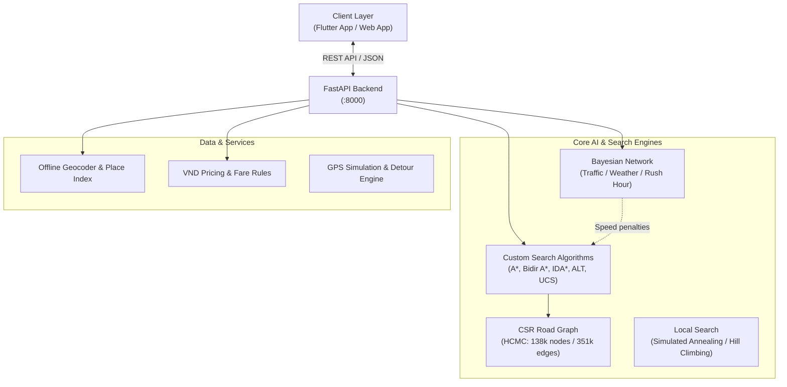

# NaVie 🧭

**Vietnam Multimodal Route Planner & Driver-Mode Navigation App**  
*Class Project — Introduction to AI (261_72ITSE30303_01)*  
*Instructor: Dr. Huy T. Nguyen*

[](https://www.python.org/)
[](https://fastapi.tiangolo.com/)
[](https://flutter.dev/)
[](https://maplibre.org/)
[](#)

---

## 📌 Project Overview

**NaVie** is a multimodal route planner and real-time turn-by-turn navigation app tailored specifically for Vietnam's transportation ecosystem (Ho Chi Minh City, Hanoi, and intercity corridors). 

The application is engineered from the ground up for the **Introduction to AI** curriculum, centering on **our own from-scratch implementations of fundamental and advanced search algorithms, probabilistic graphical models, and metaheuristics** — completely avoiding blackbox shortest-path libraries.

### 🌟 Key Highlights

- **From-Scratch Search Algorithms**: UCS (Dijkstra), Greedy Best-First, A* (Haversine & Euclidean heuristics), Bidirectional Search, Bidirectional A*, IDA*, ALT (Landmarks & Triangle Inequality), and Dynamic Replanning (D* Lite concepts).
- **Bayesian Network Traffic Congestion Model**: Discrete Bayesian Network modeling weather, peak-hour rush, rain/flooding, and road class to predict dynamic speed degradations and time-dependent edge weights.
- **Multimodal Route Planning**: Compare walking, motorbike, car, taxi, and intercity transit (bus, train, flight) with realistic travel times, distances, and VND costs.
- **Real-Time Driver Mode**: Interactive MapLibre GL UI with turn-by-turn instruction cards, text-to-speech audio guidance (Vietnamese & English), heading smoothing, off-route auto-rerouting, and a 1–10× GPS driving simulator.
- **Algorithm Comparison Lab**: Interactive in-app visualizer comparing search metrics (runtime, nodes explored, path cost, memory usage) with visual rendering of explored search trees.
- **Strict Compliance & Zero Cost**: Zero paid APIs ($0 operating cost), fully offline OSM graph indices, and proper territorial representation (Hoàng Sa & Trường Sa belong to Vietnam).

---

## 👥 Team Members & Roles

| Role | Member | Student ID | GitHub | Primary Responsibilities |
|---|---|---|---|---|
| **P1** | **Trần Quang Minh** | *247480201* | [@minhtran27042006-code](https://github.com/minhtran27042006-code) | **Data & AI**: OSM ingest, CSR road graphs, Bayesian Network traffic model |
| **P2** | **Lưu Gia Bảo** *(Leader)* | *247480201* | [@bao-rblx](https://github.com/bao-rblx) | **Backend & Algorithms**: Search engine, A*, IDA*, ALT, bidirectional search, FastAPI API |
| **P3** | **Nguyễn Trung Đức** | *247480201* | [@Kaizawa388222](https://github.com/Kaizawa388222) | **App & Frontend**: Flutter app, MapLibre GL maps, driver mode UI, TTS guidance |
| **P4** | **Nguyễn Võ Minh Nguyên** | *247480201* | [@akemoto1995](https://github.com/akemoto1995) | **QA, Infra & Logistics**: Benchmark suite, CI/CD, local search (SA/HC), documentation |

---

## 🏛️ System Architecture



---

## 🚀 Quick Start Guide

### Option 1: 1-Click Launch (Windows)

Simply double-click:
```bat
run.bat
```
This automatically initializes the FastAPI backend on `http://127.0.0.1:8000` and launches the responsive client at `http://127.0.0.1:8080`.

To stop all background services, run:
```bat
stop.bat
```

---

### Option 2: Manual Terminal Execution

#### 1. Setup Environment
```bash
# Clone the repository
git clone https://github.com/bao-rblx/NaVie.git
cd NaVie

# Install backend dependencies
cd backend
python -m venv .venv
# Windows:
.venv\Scripts\activate
# Linux/macOS:
# source .venv/bin/activate
pip install -e ".[dev]"
cd ..
```

#### 2. Start the Backend API
```bash
cd backend
python -m uvicorn navie.main:app --host 127.0.0.1 --port 8000 --reload
```
API Documentation (Swagger UI) is available at: [http://127.0.0.1:8000/docs](http://127.0.0.1:8000/docs)

#### 3. Start the Web App
In a separate terminal:
```bash
python -m http.server 8080 --bind 127.0.0.1 --directory app/web_app
```
Open your browser and navigate to: [http://127.0.0.1:8080](http://127.0.0.1:8080)

#### 4. Run the Flutter Mobile/Desktop Client (Optional)
```bash
cd app
flutter pub get
flutter run -d chrome
```

---

## 🧪 Testing & Validation

All tests adhere to strict deterministic assertions with fixed seeds. No external paid APIs or network calls are required.

```bash
# Run backend test suite with coverage
cd backend
pytest --cov=navie tests/

# Run app static analysis
cd ../app
flutter analyze
flutter test
```

Or via Makefile:
```bash
make lint    # Runs ruff, mypy, and flutter analyze
make test    # Runs pytest and flutter test
make bench   # Generates algorithm performance benchmarks in report/figures/
```

---

## 📂 Repository Structure

```text
NaVie/
├── backend/                  # Python 3.11 + FastAPI backend
│   ├── navie/
│   │   ├── graph/            # Compressed Sparse Row (CSR) graph & spatial index
│   │   ├── search/           # A*, Bidirectional A*, IDA*, ALT, UCS, Greedy
│   │   ├── traffic/          # Bayesian Network model & inference engine
│   │   ├── cost/             # Fuel, taxi, transit fare calculation engines
│   │   └── api/              # Route, geocode, and simulation endpoints
│   └── tests/                # Unit, property, and benchmark tests
├── app/                      # Flutter client
│   ├── lib/                  # Riverpod state, MapLibre widgets, driver mode
│   └── web_app/              # Standalone zero-dependency responsive web client
├── data/                     # OSM extracts, geocoding gazetteers, timetables
├── docs/                     # Specifications, architecture, and roadmap
│   ├── 00_brief.md           # Project brief & requirements
│   ├── 02_architecture.md    # API contracts & schemas
│   └── 03_algorithms.md      # Search algorithm pseudocode & proofs
├── report/                   # Course presentation slides, validation logs, audit
└── scripts/                  # Graph building, geocoding, and workflow scripts
```

---

## 📜 Academic Integrity & Disclosure

This project was developed for the **Introduction to AI** course. In accordance with course guidelines and `report/ai_usage_log.md`:
- All graph algorithms, Bayesian network implementations, and search heuristics are written and owned by the student team.
- Library routing engines (`networkx.shortest_path`, `OSRM`, `Valhalla`) are used solely in `backend/tests/` as benchmark oracles to verify correctness.
- AI coding assistants were utilized as supportive development tools under team supervision; complete prompts, decisions, and commit histories are audited and logged in [report/ai_usage_log.md](report/ai_usage_log.md).

---

© 2026 NaVie Team. Developed for Introduction to AI Coursework.
